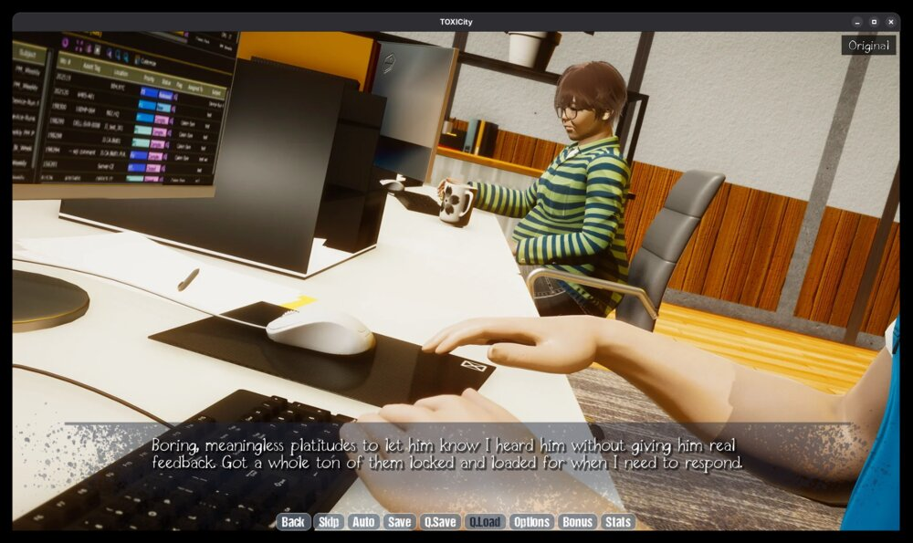
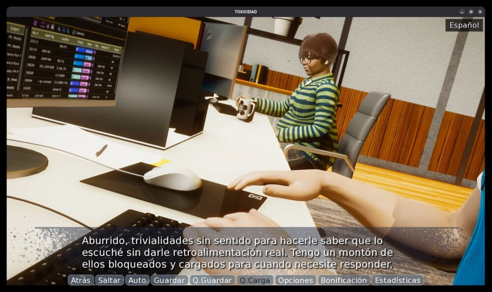
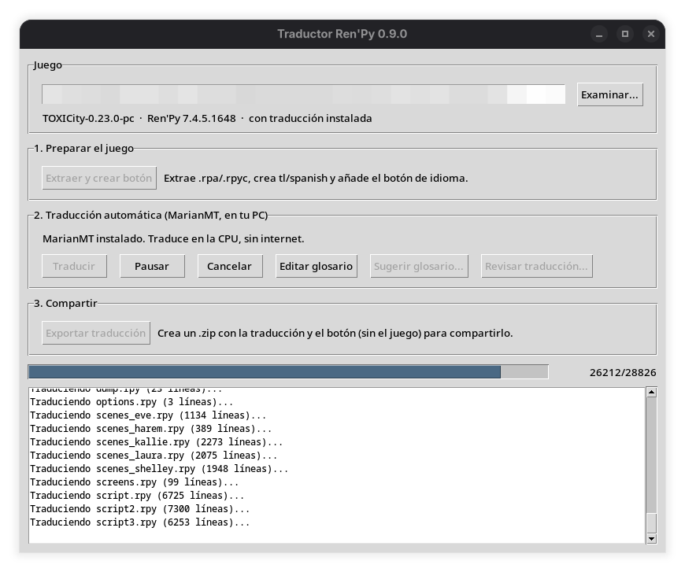
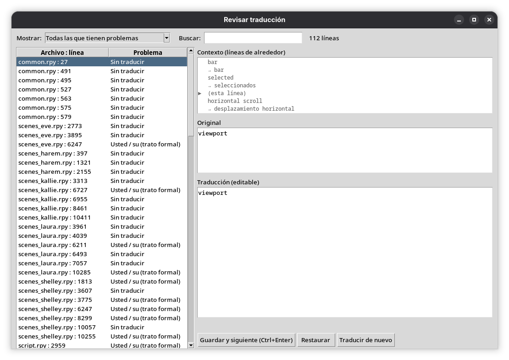

# Traductor Ren'Py

**Versión 0.9.0** · en desarrollo: funciona, pero aún le faltan detalles por pulir.

Traduce juegos de **Ren'Py** del inglés al **español** sin tocar el código del
juego. Todo funciona en tu PC, sin internet y sin censura: usa **MarianMT**
(`Helsinki-NLP/opus-mt-tc-big-en-es`) acelerado con **CTranslate2** en la CPU.

Funciona en **Windows** y **Linux**, con juegos de Ren'Py 6.99, 7 y 8.

## Capturas

**Antes y después** (TOXICity, Ren'Py 7.4: 28.826 líneas traducidas en unos 24 minutos):

| Original | Traducido |
| --- | --- |
|  |  |

| La app traduciendo | Revisión de las líneas dudosas |
| --- | --- |
|  |  |

## Qué hace

1. **Prepara el juego**: extrae los `.rpa`, decompila los `.rpyc` (con
   [unrpyc](https://github.com/CensoredUsername/unrpyc)), genera `game/tl/spanish`
   con el propio motor del juego y añade un botón para cambiar de idioma
   (arriba a la derecha, o Mayús+L).
2. **Traduce** con MarianMT, comprueba con el motor del juego que todo carga sin
   errores y guarda una copia de seguridad antes de tocar nada.
3. **Revisa**: una pantalla lista las líneas sospechosas (sin traducir, trato de
   usted, variables cambiadas…) con su contexto, para corregirlas a mano o pedir
   otra traducción.
4. **Exporta** un `.zip` pequeño con solo la traducción y el botón, para
   compartirlo sin el juego.

## Mejoras sobre MarianMT "a secas"

- **Tuteo**: el lector siempre es "tú", no "usted" (incluidos los imperativos:
  "Wait." → "Espera.", "siéntase" → "siéntete").
- **Variables y etiquetas** (`[name]`, `{b}…{/b}`) dentro de la frase no la parten.
- **Signos ¿ ¡**, tartamudeos (`T-That`), guiones de interrupción, nombres con
  tildes o diéresis y abreviaturas (`Ms.`, `Dr.`) bien tratados.
- Detecta y **reintenta el texto basura** que a veces suelta el modelo
  ("Me gusta Cargando…"); nunca lo guarda.
- **Glosario** de traducciones fijas y sugerencias automáticas de nombres.
- **Fuentes sin tildes ni ñ**: detecta las fuentes del juego a las que les faltan
  letras del español y, solo en la traducción, las cambia por DejaVuSans (incluida
  en Ren'Py) para que no salga "Espa ol".
- Varios procesos de MarianMT en paralelo; si uno se cae, se reinicia solo.

## Requisitos

- **Python 3** con tkinter.
  - Windows: viene con el instalador de python.org.
  - Linux: `sudo pacman -S tk` (Arch), `sudo apt install python3-tk`
    (Debian/Ubuntu) o `sudo dnf install python3-tkinter` (Fedora).
- El juego tiene que incluir su versión para tu sistema (en Linux,
  `lib/py*-linux-x86_64`).

La primera vez que traduces, la app descarga MarianMT en la carpeta
`herramientas/` (~1 GB temporal; luego ocupa unos 450 MB).

## Uso

- **Windows**: doble clic en `Traductor.bat`.
- **Linux**: ejecuta una vez `./crear_acceso_directo.sh` y abre
  **Traductor Ren'Py** desde el menú de aplicaciones (o usa `./Traductor.sh`).

Luego: **Examinar** (elige el `.exe`/`.sh` del juego) → **Extraer y crear
botón** → **Traducir**. Más detalles en [`LEEME.txt`](LEEME.txt).

## Límites conocidos

- El género de "you" lo decide el modelo (escéptico / escéptica).
- Algunos "le/les" de usted no se detectan.
- Palabras raras o argot pueden salir mal: usa el glosario.

## Créditos

- [MarianMT / OPUS-MT](https://github.com/Helsinki-NLP/Opus-MT), Helsinki-NLP (CC-BY 4.0).
- [CTranslate2](https://github.com/OpenNMT/CTranslate2), OpenNMT.
- [unrpyc](https://github.com/CensoredUsername/unrpyc), CensoredUsername.

## Licencia

[MIT](LICENSE) © 2026 kasutago. Las herramientas y el modelo de los créditos
tienen sus propias licencias.
